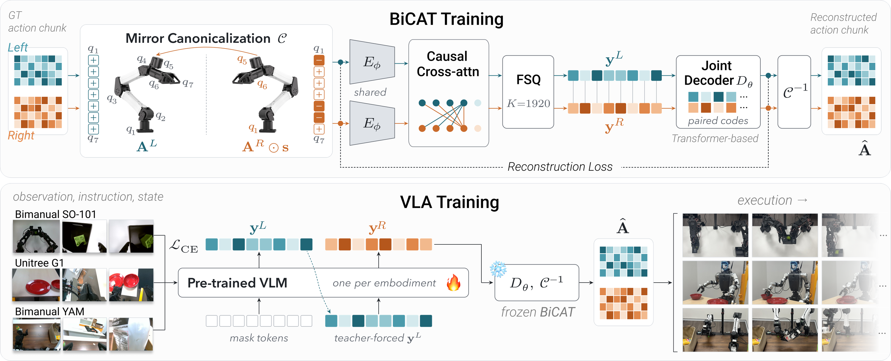

<div align="center">

# BiCAT: Bimanual Coordination Action Tokenization

[Xuanwei Liu](https://evan-xliu.github.io/),
Guipu Cao,
Zhongyi Luo,
[Jiafei Duan](https://jiafei1224.github.io/)<sup>†</sup>

National University of Singapore

[Paper](https://magiclab-nus.github.io/BiCAT/BiCAT.pdf) · [Project Page](https://magiclab-nus.github.io/BiCAT/) · [BibTeX](#citation)

<!-- TODO: add a teaser figure, e.g. assets/teaser.png -->
<!--  -->

</div>

## Overview

<p align="center">
  
</p>

## Contents

- [Installation](#installation)
- [Data](#data)
- [Train the BiCAT Tokenizer](#train-the-bicat-tokenizer)
- [Train the BAR Policy](#train-the-bar-policy)
- [Serve and Evaluate on RoboTwin](#serve-and-evaluate-on-robotwin)
- [Repository Layout](#repository-layout)
- [Citation](#citation)
- [Acknowledgements](#acknowledgements)

## Installation

The reference environment uses Python 3.10.21, PyTorch 2.7.1, torchvision
0.22.1, Transformers 4.57.6, LeRobot 0.4.4, datasets 4.1.1, NumPy 2.2.5, PEFT
0.18.1, PyAV 15.1.0, and wandb 0.24.2:

```bash
git clone https://github.com/Evan-XLiu/BiCAT.git
cd BiCAT
uv python install 3.10.21
uv sync --python 3.10.21 --extra pali --extra molmo --extra serving --extra logging
uv pip install --python .venv/bin/python \
  'torch==2.7.1' 'torchvision==0.22.1' 'transformers==4.57.6' \
  'lerobot==0.4.4' 'datasets==4.1.1' 'numpy==2.2.5' \
  'peft==0.18.1' 'av==15.1.0' 'wandb==0.24.2'
.venv/bin/python -c "import bicat; print('bicat import OK')"
```

Extras: `pali`, `molmo` (VLM backbones), `serving` (gRPC policy server), and
`logging` (wandb). Cache the backbone weights before offline training:

```bash
export HF_HOME="$PWD/.cache/huggingface"
export HF_MODULES_CACHE="$HF_HOME/modules"
.venv/bin/hf download allenai/Molmo2-ER --local-dir .cache/models/Molmo2-ER
.venv/bin/hf download google/paligemma2-3b-mix-224   # requires accepted access
```

Molmo2-ER loads its native processor and model code with
`trust_remote_code=True`.

## Data

Datasets must be in LeRobot v3 format. Actions are bimanual joint targets laid
out as `[left arm joints, left gripper, right arm joints, right gripper]`
(14-D for two 6-DoF arms with grippers).

1. Copy [`configs/dataset/example.yaml`](src/bicat/configs/dataset/example.yaml)
   to `configs/dataset/<name>.yaml` and set `root`, `action_key`, and
   `observation_keys`. Select it with `dataset=<name>`.
2. Set the BiCAT action convention for your robot in the codec config
   ([`tokens/bicat.yaml`](src/bicat/configs/codecs/tokens/bicat.yaml)):
   - `right_arm_sign`: per-joint signs (`+1`/`-1`) that mirror the right arm
     into the left arm's convention.
   - `shared_action_min` / `shared_action_max`: per-joint extrema pooled over
     `left[:, j]` and `right[:, j] * right_arm_sign[j]`. Both arms share this
     single range. The shipped defaults are the RoboTwin (aloha-agilex) ranges.
   - `action_dim` / `arm_dim` if the arms are not 7-D (for example 16 / 8).

   [`scripts/tokenizer/prepare_bicat_joint_all.py`](scripts/tokenizer/prepare_bicat_joint_all.py)
   merges multi-task YAM recordings into one action-only dataset and prints the
   shared ranges.

## Train the BiCAT Tokenizer

```bash
.venv/bin/bicat-train --config-name train_codecs \
  codecs@codec=tokens/bicat dataset=<name> \
  output_dir=outputs/bicat_tokenizer \
  trainer.max_steps=300000
```

The trained codec is written to
`outputs/bicat_tokenizer/checkpoints/<latest|best/step_N>/pretrained_model`,
together with `policy_io.json` and `norm_stats.pt`.

Evaluate reconstruction error on the held-out split:

```bash
.venv/bin/python scripts/tokenizer/evaluate_reconstruction.py \
  --checkpoint outputs/bicat_tokenizer/checkpoints/latest
```

## Train the BAR Policy

| Policy | Backbone | Tokenizer |
| --- | --- | --- |
| `bar_bicat_pali` | PaliGemma2-3B | `bicat` |
| `bar_bicat_molmo` | Molmo2-ER | `bicat` |

Single GPU:

```bash
.venv/bin/bicat-train policy=bar_bicat_pali dataset=<name> \
  policy.action_tokenizer.pretrained_path=/abs/path/to/pretrained_model \
  output_dir=outputs/bar_bicat_pali
```

Four GPUs on one machine, with Molmo2-ER:

```bash
export CUDA_VISIBLE_DEVICES=0,1,2,3
export HF_HOME="$PWD/.cache/huggingface" HF_MODULES_CACHE="$PWD/.cache/huggingface/modules"
export OMP_NUM_THREADS=4 MKL_NUM_THREADS=4
export PYTORCH_CUDA_ALLOC_CONF=expandable_segments:True

.venv/bin/torchrun --standalone --nnodes=1 --nproc_per_node=4 \
  -m bicat.scripts.train \
  policy=bar_bicat_molmo dataset=<name> \
  "policy.vlm_model_name=$PWD/.cache/models/Molmo2-ER" \
  "policy.action_tokenizer.pretrained_path=/abs/path/to/pretrained_model" \
  output_dir=outputs/bar_bicat_molmo \
  trainer.distributed_strategy=ddp \
  trainer.batch_size=32 \
  trainer.global_batch_size=128 \
  trainer.gradient_accumulation_steps=1 \
  trainer.num_workers=2 \
  trainer.max_steps=30000
```

`trainer.global_batch_size` sets the effective batch; the per-GPU batch is
`global_batch_size / (num_gpus * gradient_accumulation_steps)` and must divide
exactly. If memory is tight, use batch 16 with accumulation 2, enable
`policy.freeze_vision_encoder=true`, or use `trainer.distributed_strategy=fsdp`.

Notes:

- The default `run_mode=overwrite` deletes `output_dir` first; use a fresh
  directory per run. To resume, pass `run_mode=resume
  resume_checkpoint=<output_dir>/checkpoints/latest`.
- Policy checkpoints do not embed the frozen tokenizer weights; keep the
  tokenizer `pretrained_model` directory at the configured path.
- Set `trainer.use_wandb=false` to train without wandb.

## Serve and Evaluate on RoboTwin

Start the gRPC policy server:

```bash
.venv/bin/bicat-serve policy=bar_bicat_pali \
  policy.pretrained_path=/abs/path/to/policy/pretrained_model
```

Use the policy name the checkpoint was trained with (for example
`policy=bar_bicat_molmo`).

Then run one official RoboTwin 2.0 task against it. `--expected-checkpoint`
must be the same `pretrained_model` directory; the evaluator checks the served
checkpoint identity before rolling out.

```bash
.venv/bin/python scripts/robotwin/run_eval.py \
  --robotwin-root /path/to/RoboTwin \
  --task stack_blocks_two \
  --episodes-per-task 100 --record-episodes-per-task 0 \
  --policy-port 50051 \
  --output-dir outputs/robotwin_eval \
  --run-id bar_bicat_pali \
  --expected-checkpoint /abs/path/to/policy/pretrained_model
```

[`scripts/robotwin/run_suite.py`](scripts/robotwin/run_suite.py) runs and
aggregates the full task list in
[`scripts/robotwin/all_tasks.yml`](scripts/robotwin/all_tasks.yml) across several
servers and GPUs.

## Repository Layout

```text
src/bicat/codecs/tokens/bicat/   BiCAT tokenizer (encoder, decoder, FSQ tokens)
src/bicat/policies/bar/          BAR policy, blockwise decoding, backbones
src/bicat/policies/backbones/    PaliGemma2 and Molmo2-ER adapters
src/bicat/training/              codec and policy trainers, checkpointing
src/bicat/serving/               gRPC policy server
src/bicat/configs/               Hydra configs (codecs, policy, dataset, trainer)
scripts/tokenizer/               data preparation and reconstruction eval
scripts/robotwin/                RoboTwin 2.0 evaluation
```

## Citation

If you find BiCAT useful in your research, please cite:

<!-- TODO: update the venue, year, and arXiv ID once available. -->
```bibtex
@article{liu2026bicat,
  title   = {BiCAT: Bimanual Coordination Action Tokenization},
  author  = {Liu, Xuanwei and Cao, Guipu and Luo, Zhongyi and Duan, Jiafei},
  journal = {arXiv preprint arXiv:XXXX.XXXXX},
  year    = {2026}
}
```

## Acknowledgements

This codebase is built on [Praxis](https://github.com/Chaoqi-LIU/praxis-vla).

## License

Released under the Apache-2.0 license. See [LICENSE](LICENSE).
